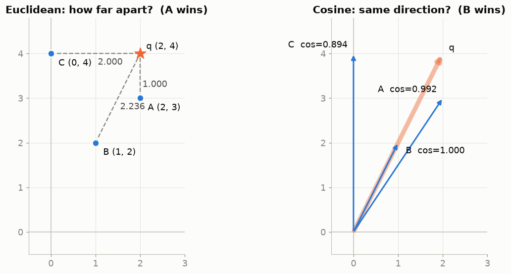
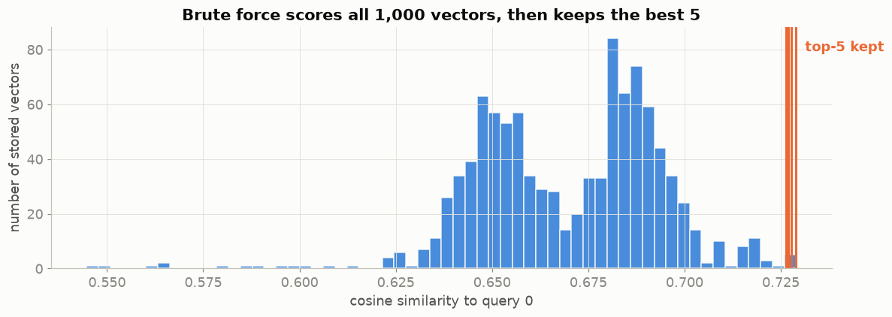
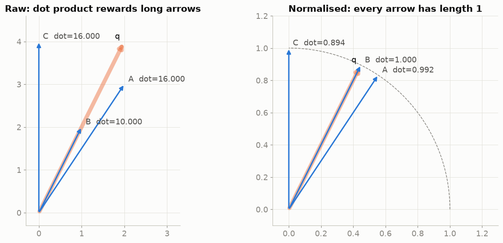
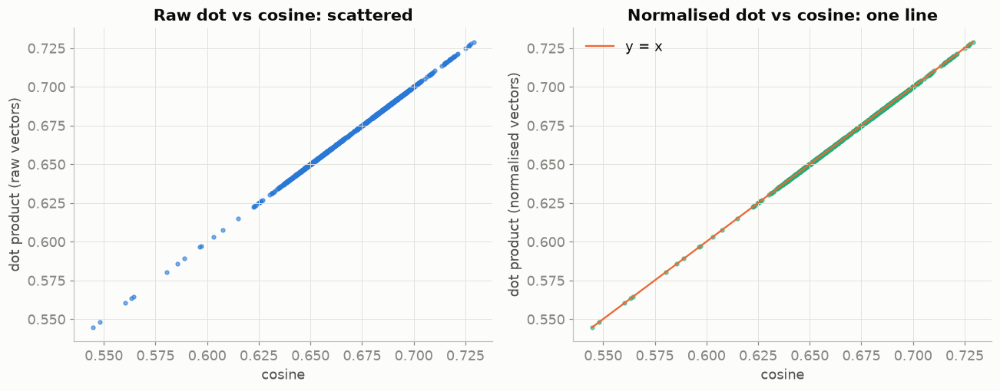
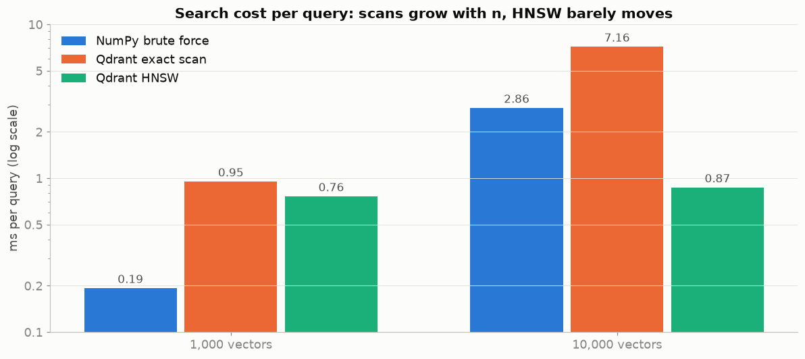
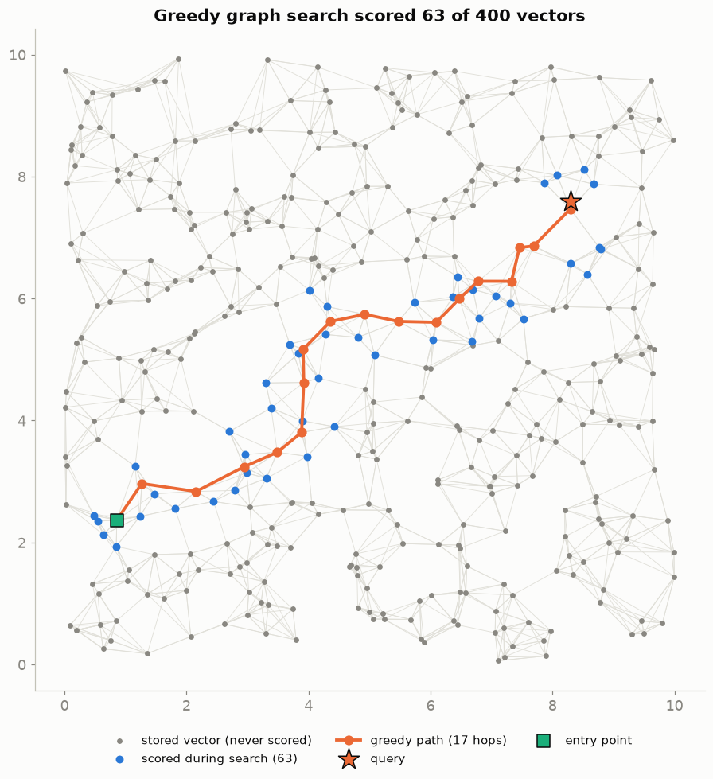

# Vector DB Basics: what a vector database actually computes

A vector database does one calculation: it **scores a query vector against stored vectors and returns the best _k_**.
This project computes that by hand and in NumPy, checks that **Qdrant returns exactly the same answer**, and then measures what an **HNSW index** changes.

Everything is in one self-contained notebook, **[`vector_search_complete.ipynb`](vector_search_complete.ipynb)**, with a comment on every line of code.

The data is **1,000 SENTINEL fraud-investigation text chunks embedded with Gemini Embedding 2** (3072 dimensions), searched on **Qdrant Cloud**.

---

## Contents

| Part | What it shows |
|---|---|
| 0. Setup | libraries, `.env` configuration, Qdrant connection, loading the 1,000 vectors |
| 1. By hand | Euclidean distance and cosine similarity for the 2D class example, step by step |
| 2. NumPy top-k | brute-force search over 1,000 × 3072 vectors, both metrics |
| 3. Qdrant = NumPy | the same queries in Qdrant (exact scan and HNSW) return the same ids and scores |
| 4. Normalisation | why cosine and dot product give the same ranking once vectors have length 1 |
| 5. Timing | NumPy vs Qdrant at 1,000 and 10,000 vectors, with server time vs round trip |
| 6. HNSW | what the index changes, plus a toy graph search drawn step by step |
| 7. Summary | the main points in two tables |

---

## The two scores

**Euclidean distance**, the straight-line gap (smaller = closer):

$$d(a,b) = \sqrt{\sum_i (a_i - b_i)^2}$$

**Cosine similarity**, the angle between two arrows from the origin (bigger = closer):

$$\cos(a,b) = \frac{a \cdot b}{|a|\,|b|}$$

---

## Results

### 1. The class example, by hand

Stored points A = (2,3), B = (1,2), C = (0,4); query q = (2,4); |q| = √20 ≈ 4.472.

| point | Euclidean to q | cosine with q |
|---|---|---|
| A (2,3) | √(0² + 1²) = **1.000** | 16 / (3.606 × 4.472) = 0.992 |
| B (1,2) | √(1² + 2²) = 2.236 | 10 / (2.236 × 4.472) = **1.000** |
| C (0,4) | √(2² + 0²) = 2.000 | 16 / (4.000 × 4.472) = 0.894 |

- **Euclidean ranking:** A, C, B.
- **Cosine ranking:** B, A, C.

B is exactly half of q: the same direction with a shorter arrow. Cosine only measures direction, so B scores a perfect 1.0. Euclidean measures the gap between points, so B is the furthest.



### 2. Brute-force top-k in NumPy

Brute force scores the query against **every** stored vector and keeps the best *k*. The whole search is one matrix-vector product:

```python
sims = (X @ q) / (np.linalg.norm(X, axis=1) * np.linalg.norm(q))   # 1,000 cosines at once
idx  = np.argpartition(-sims, k)[:k]                                # the k best, O(n)
idx  = idx[np.argsort(-sims[idx])]                                  # sort only those k
```

Euclidean reuses the same product: |x − q|² = |x|² − 2·x·q + |q|².

The best match for each query, from the real SENTINEL chunks:

| query | best cosine hit (start of chunk) |
|---|---|
| unauthorised UPI payment late at night after several failed attempts | *Dispute intake and evidence review … Unauthorised …* |
| new device login followed by a sudden spike in transaction amount | *Synthetic RBI topic exercise … on device change* |
| what evidence should an investigator collect for a chargeback dispute | *Dispute intake and evidence review … Duplicate …* |

Cosine scores of the top-5 hits fall between 0.64 and 0.75.



### 3. Qdrant returns exactly what NumPy returns

The Qdrant collection stores each vector twice: as `cos` (`Distance.COSINE`) and as `euc` (`Distance.EUCLID`). Point id = NumPy row number. The HNSW index is forced on, because Qdrant normally just scans collections this small.

| check | result |
|---|---|
| 5 queries × 2 metrics × {exact scan, HNSW} | **20 / 20 identical** (same ids, same order) |
| largest score difference | **3.6e-07** (float32 rounding) |

Qdrant's `COSINE` score *is* the cosine similarity, and its `EUCLID` score *is* the Euclidean distance.

### 4. Normalisation: cosine = dot product

Scale every vector to length 1 and the denominator of the cosine becomes 1 × 1, so **cos(a,b) = a · b**. That gives the same number for every pair, so the ranking is the same. For unit vectors Euclidean agrees too, because |a − b|² = 2 − 2·cos(a,b).

**2D example:** the raw dot product ranks A and C first (both 16, because their arrows are longer). After normalising, the dot product gives B, A, C: exactly the cosine ranking.



**Gemini Embedding 2 vectors already have length 1.000** (checked in Part 0). So on the real data, normalising changes nothing, and all four rankings agree for every query:

| ranking method | same top-10 as cosine? |
|---|---|
| dot product on normalised vectors | ✅ all 5 queries |
| Euclidean on normalised vectors | ✅ all 5 queries |
| dot product on **raw** Gemini vectors | ✅ all 5 queries (they are already unit length) |
| Qdrant `DOT` (normalised) vs Qdrant `COSINE` (raw) | ✅ identical ids, score diff ≤ 2.4e-07 |

The same thing explains the left panel below: it is a straight line, not a scatter. The raw dot product differs from cosine only when vector lengths differ, as in the 2D example (or with the synthetic vectors the notebook uses when there is no API key, whose lengths range from 0.5 to 2.0).

This is also how Qdrant implements `COSINE`: it normalises each vector once, on insert, and every search is then a plain dot product.



### 5. Timing: brute force vs Qdrant

100 queries per size, top-10, cosine, 3072 dims, Qdrant Cloud (AWS sa-east-1). The 10,000-vector set is synthetic, because 10,000 real embeddings would exceed the API's daily token limit. Speed depends only on how many vectors there are and their size.

| vectors | NumPy brute force | Qdrant exact, server | Qdrant HNSW, server | Qdrant round trip | HNSW recall@10 |
|---:|---:|---:|---:|---:|---:|
| 1,000 | 0.19 ms | 0.95 ms | 0.76 ms | ~368 ms | 1.000 |
| 10,000 | 2.86 ms | 7.16 ms | 0.87 ms | ~368 ms | 0.997 |

- **Server time** is the `time` field Qdrant returns: the search alone. **Round trip** is the wall-clock time in Python.
- The ~368 ms round trip is almost entirely network delay to the São Paulo region, and it is the same for every method and size. That is why the comparison with NumPy uses server time.
- At both sizes, Qdrant's exact search returned the same top-10 as NumPy for **100/100 queries**.
- Upload over the internet took 13 s for 1,000 vectors and 126 s for 10,000. The HNSW build took 0.3 s and 1.7 s.

What the numbers show:

- **NumPy and Qdrant's exact scan grow linearly.** 10× the vectors meant about 15× (NumPy) and 7.5× (Qdrant) the time.
- **HNSW stays almost flat:** 0.76 ms → 0.87 ms. At 10,000 vectors it is already 8× faster than Qdrant's own scan and 3× faster than NumPy.
- **At 1,000 vectors brute force is fine,** and even fastest. One small matrix product is cheap.
- **The price of HNSW is recall:** 0.997, not 1.0. It is approximate.



### 6. What an HNSW index changes

**HNSW (Hierarchical Navigable Small World) does not change the score formula. It changes which vectors get scored.**

- **Without an index**, every query is compared with all *n* vectors. The cost is about *n × d* and the answer is exact.
- **With HNSW**, a graph is built at insert time. Each vector links to about `m` = 16 near neighbours, and sparser upper layers act as express lanes. A query starts at the top layer and greedily hops to whichever neighbour is closer to the query. When no neighbour is closer it drops a layer. On the bottom layer it keeps a shortlist of size `ef`. It scores a few hundred vectors whatever *n* is, so the cost grows roughly with **log n**.
- **The cost:** answers are approximate (recall < 1), and the graph takes build time and memory. `m`, `ef_construct` and `hnsw_ef` trade recall against speed.
- **In Qdrant:** segments below `indexing_threshold` / `full_scan_threshold` (about 10 MB by default) are scanned, not indexed. `exact=True` forces a scan, which is how recall is measured.

The toy one-layer version in the notebook found the true nearest point after scoring **63 of 400** points (16%):



---

## Summary

| | Brute force (no index) | HNSW index |
|---|---|---|
| Vectors scored per query | all *n* | a few hundred, found by walking a graph |
| Cost per query | grows with *n × d* | grows roughly with log *n* |
| Answer | exact | approximate (recall 0.997 here) |
| Extra cost | none | build time and memory for the graph |
| Best for | small collections, ground truth | large collections, low latency |

**A vector database computes nothing magic. The index only decides *which* vectors are worth scoring.**

---

## How to run it

### 1. Environment

```bash
python -m venv vdb_task
vdb_task\Scripts\activate
pip install -r requirements.txt
```

The second line is for Windows. On macOS/Linux, run `source vdb_task/bin/activate` instead.

### 2. `.env`

Copy the template and fill in your keys. `.env` is ignored by git, so it never gets committed.

```bash
copy .env_example .env
```

That command is for Windows. On macOS/Linux, use `cp .env_example .env`. The template contains:

```ini
# Qdrant: leave QDRANT_API_KEY empty to use a local Docker Qdrant instead
QDRANT_URL=https://<cluster-id>.<region>.aws.cloud.qdrant.io:6333
QDRANT_API_KEY=<your Qdrant Cloud API key>

# Embeddings: leave EURI_API_KEY empty to use synthetic 3072-dim vectors instead
EURI_API_KEY=<your Euron API key>
EURI_BASE_URL=https://api.euron.one/api/v1/euri
EMBED_MODEL=gemini-embedding-2

# Optional: where the SENTINEL chunk files are (only needed if data/ is missing)
CHUNKS_GLOB=C:\path\to\sentinel_data\tables\document_chunks\*\*.csv.gz
```

The notebook adapts to what is set:

| setting | set | empty |
|---|---|---|
| `QDRANT_API_KEY` | uses Qdrant Cloud at `QDRANT_URL` | uses local Docker: `docker run -p 6333:6333 -p 6334:6334 qdrant/qdrant:v1.20.0` |
| `EURI_API_KEY` | uses Gemini Embedding 2 vectors | uses 1,000 synthetic 3072-dim vectors (lengths 0.5–2.0) |

**Cached embeddings:** the 1,000 Gemini vectors, the 5 query vectors and their texts are saved in `data/` (`docs.npy`, `queries.npy`, `texts.json`). When those files exist, the notebook loads them and makes **no API calls**. `EURI_API_KEY` must still be non-empty for the notebook to choose the Gemini path.

### 3. Run

```bash
jupyter notebook vector_search_complete.ipynb
```

Then choose **Run All**. Part 5 uploads 11,000 vectors, so it takes a few minutes against Qdrant Cloud. The notebook deletes the collections it creates at the end.

---

## Project files

| path | what it is |
|---|---|
| `vector_search_complete.ipynb` | the whole project: code, explanations, results and plots |
| `data/` | cached Gemini Embedding 2 vectors (1,000 docs and 5 queries) and the chunk texts |
| `images/` | plots exported from the notebook, used in this README |
| `requirements.txt` | Python dependencies |
| `.env_example` | template for `.env`, with placeholders and an explanation of each setting |
| `.env` | your API keys (not committed) |
| `vdb_task/` | local virtual environment (not committed) |

## Tech stack

Python · NumPy · pandas · Matplotlib · Qdrant (Cloud, `qdrant-client`) · Gemini Embedding 2 (via the Euron gateway) · Jupyter
